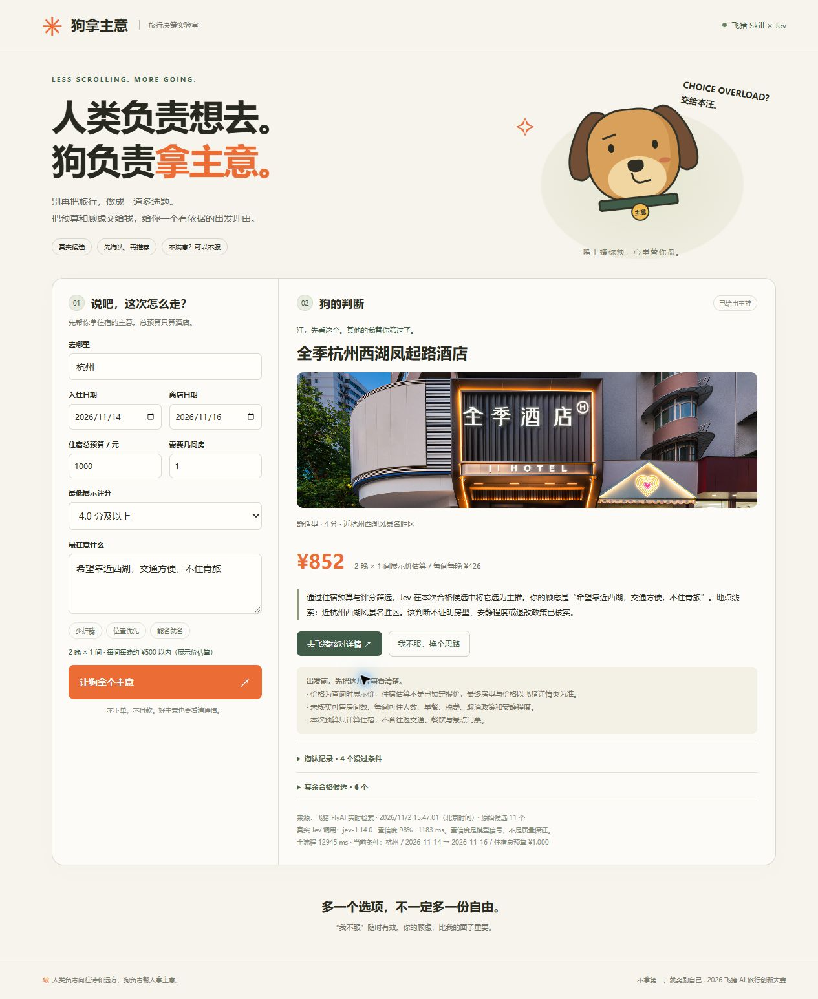

# 🐕 狗拿主意

人类负责向往诗和远方，狗负责帮人拿主意。

**队伍：不拿第一，就奖励自己** · 口号：懒才是进步的阶梯

一个嘴上不饶人、实际上认真负责的旅行决策狗。当前版本实现**酒店决策闭环**：飞猪真实检索 → 程序筛选日期与住宿预算 → TypeSafe Jev 辅助选择 → 一个主推、淘汰记录、风险提示 → “我不服”增量重选。



## 启动

需要 Node.js 22.18+。使用你自己的飞猪、TypeSafe API Key。

```powershell
npm ci
Copy-Item .env.example .env
# 编辑 .env 填写 FLYAI_API_KEY 与 TYPESAFE_API_KEY
npm start
```

打开 http://127.0.0.1:3210 。Windows 可运行 `启动狗拿主意.cmd`。密钥仅保存在本机被 Git 忽略的 `.env` 中；不要上传此文件。

```powershell
npm test
npm run check
```

本项目不需要前端构建，也不增加账号、数据库或持久化用户存档。旅行条件只保留在当前页面内存，服务重启即清除限流计数。

## 真实分工

- 飞猪官方 `@fly-ai/flyai-cli` 1.0.16：执行 `search-hotel`，日期、目的地、每晚价格上限均按官方参数传入。
- 程序：严格校验日期、晚数、房间数、总住宿预算、评分、共享床位与链接；拒绝把起价、区间或未知价格当成准确金额。
- TypeSafe 官方 `https://api.typesafe.ai/v1/systemone`：发送 `state + choice question`，包括 `defer` 暂缓选项；只允许返回预先筛选的候选。检查候选 ID、完整概率分布、置信度范围，置信度低于 0.65 暂缓推荐。
- 阿里云百炼 Managed Agent：按参赛指南创建“狗拿主意”，在云端会话安装飞猪官方 Skill、执行真实酒店检索；完整会话继续验证此项目。百炼在本项目的**开发与验证链路**中使用，浏览器独立版的运行时选择由 Jev 完成；不要将此描述为浏览器请求经过百炼模型。

其他旅行品类（机票、景点等）可通过百炼会话中的官方 FlyAI Skill 查询；本独立界面尚未实现全行程预算与组合优化。

**已观察到的云端限制**：百炼沙箱中飞猪真实调用与测试正常，但 TypeSafe 官方接口返回 HTTP 451（当前地区不可用），所以该沙箱未跑通 Jev。本机完整 FlyAI + Jev 闭环已真实验证。详见 [验证记录](docs/verification.md)。

## 边界

住宿估算 = 飞猪每间每晚展示价 × 晚数 × 房间数。它不是锁定报价。未核实房型、实时库存、入住人数上限、早餐、税费、取消政策、安静程度。仅计算住宿，不含交通、餐饮、门票。

“其余合格候选”表示通过硬性条件，但本轮未主推，不编造模型未返回的淘汰理由。Jev 返回的置信度不是业务正确率或酒店质量保证。

“我不服”保留城市、日期、预算和房间数，保留原始顾虑及逐轮补充/更正记录，并排除上次主推（最新明确更正优先，其余条件保留）。顾虑需要未提供的证据或模型信号不足时，诚实暂缓。

默认仅监听本机。不要直接将带个人密钥的服务开放到公网；公开演示需要部署方提供访问控制、统一预算和更严格的限流。本次代码无下单、支付或用户身份采集逻辑。

## 百炼复现

在 Managed Agent 创建智能体，模型使用 AUTO，系统提示词参考 [项目介绍](狗拿主意项目介绍.md)。创建会话时注入 `FLYAI_API_KEY`、`TYPESAFE_API_KEY`。在云端安装：

```sh
npx --yes skills add alibaba-flyai/flyai-skill --skill flyai --agent claude-code -y
npm ci
npm test
```

读取飞猪 Skill 的 `SKILL.md` 和 `references/search-hotel.md` 后调用，不猜参数。`node scripts/decide.mjs trip.json` 可供百炼智能体调用结构化决策，其中 `trip.json` 只包含旅行条件，不包含密钥。

仓库附带 `.agents/skills/flyai` 官方文档快照，来源 `alibaba-flyai/flyai-skill` 提交 `86fe2cc3e25464d0e0bd6a769b27b5f9f3b04128`，保留上游 MIT LICENSE。遇到 GitHub 网络故障时可从此本地目录读取或安装官方 Skill，不修改上游指令正文。

官方来源：[比赛](https://opc.aliyun.com/feizhu)、[参赛指南](https://alidocs.dingtalk.com/i/nodes/QG53mjyd800agdlKHebwk4Zj86zbX04v)、[FlyAI Skill](https://github.com/alibaba-flyai/flyai-skill)、[TypeSafe API](https://docs.typesafe.ai/api/system-one)。
