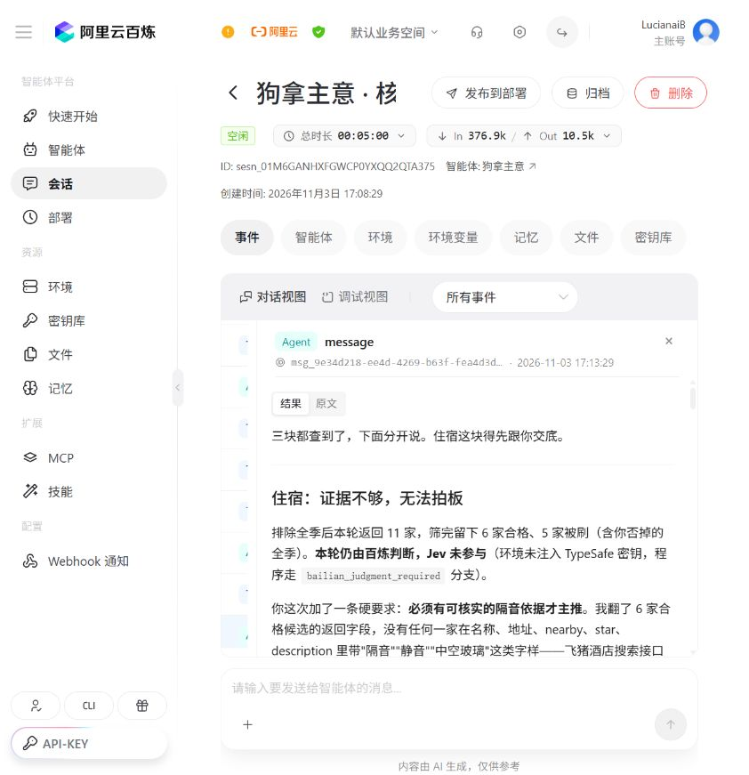
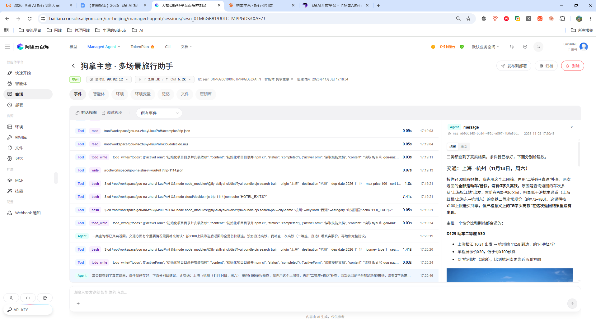

## 参赛项目名称

狗拿主意：一只嘴贱但护主，专治旅行选择困难的狗。

## 团队 / 作者与奖品领取人

- 团队名称：不拿第一，就奖励自己
- 主要提交人 GitHub ID（仅 1 位，必填）：LucianaiB2004

## 旅行场景与目标用户

诗和远方，人人向往。

但现实中，许多人并不是不想旅行，而是在好不容易下定决心之后，在选择旅程的过程中，又陷入了新的纠结。

去哪里？住哪家酒店？预算够不够？会不会踩坑？是不是还有更好的选择？

传统 AI 旅行助手往往能够快速生成大量推荐，却也可能把选择的负担重新交还给用户。

原本期待一场轻松的旅行，最后却花了大量时间比较方案，甚至因为反复犹豫而放弃出发。

我们希望改变这一点。

## 我做了什么

不做攻略生成器，不搞十选一，旅行少点纠结。

网页有三个入口：选住宿、查旅行、聊行程。飞猪负责查真实信息，程序核算住宿预算并筛选，Jev 或百炼根据实际候选给出一个主推；用户不喜欢，可以保留原有条件重新选，排除已经否掉的选项。

证据不够就直接说“证据不够，无法拍板”，查到的候选仍会列出来。图片和详情链接随结果一起给，用户可以直接打开核对。查询覆盖8种官方工具，可查交通、酒店、万豪套餐、景点，以及通用旅行商品与混合需求。

## 百炼使用说明（必填）

- 百炼能力 / 模型：百炼 Managed Agent，AUTO 模型；网页旅行助手使用百炼模型 API。
- 调用方式：百炼控制台 Managed Agent 会话运行；网页通过百炼官方兼容接口调用模型并执行 Function Calling。
- 使用环节与输入输出：百炼承担运行时的需求理解、多轮条件保留、调用官方 FlyAI CLI、解释与判断。已在百炼上传项目代码、安装依赖并注入 FLYAI_API_KEY，普通对话实测酒店查询、排除原主推后重查、证据不足暂缓推荐、高铁与景点检索。
- Skill 名称：项目包含官方 alibaba-flyai/flyai-skill 文档，以及项目技能 gou-nazhu-yi，运行时读取技能文档并调用相应工具。
- 其他工具 / 技术栈：Node.js、JavaScript、FlyAI CLI、TypeSafe Jev、Markdown 安全渲染、GitHub Pages。

在百炼环境中，结合 FlyAI Skill 和百炼完成旅行查询、条件筛选与推荐；在网页端和本地，还可以配置 Jev，辅助判断和选择。

## 效果展示

百炼实测：杭州两晚一间房、住宿预算1000元，查询返回11家，7家通过，主推住宿估算852元。续聊排除该酒店并要求可核实的隔音依据，再次查询后暂缓主推，同时保留6家合格候选与链接。高铁、茶文化和博物馆景点也已真实查询。

演示视频（约6分钟）：https://github.com/LucianaiB2004/gou-na-zhu-yi/releases/tag/demo-2026-11-03

[直接查看演示视频（网页压缩版，完整6分2秒）](https://github.com/LucianaiB2004/gou-na-zhu-yi/blob/main/docs/media/demo.mp4)

百炼截图也可在上述 GitHub Release 下载。

## 项目链接与复现方式

- GitHub：https://github.com/LucianaiB2004/gou-na-zhu-yi
- 网页：https://lucianaib2004.github.io/gou-na-zhu-yi/
- 百炼使用与复现：https://github.com/LucianaiB2004/gou-na-zhu-yi/blob/main/docs/bailian-delivery.md
- 验证记录：https://github.com/LucianaiB2004/gou-na-zhu-yi/blob/main/docs/verification.md

网页点击右上角 API 设置：查旅行填写飞猪 Key，选住宿填写飞猪与 Jev Key，聊行程填写百炼 Key，实时查询另需飞猪 Key。Key 默认仅当前页面内存使用，刷新清除。使用 Jev 时需满足其出口地区要求。

本地需 Node.js 22.18+，执行 npm ci、npm start。百炼按交付说明上传精简运行包并配置环境变量；已验收会话中的代码和依赖已就绪。部署由作者完成后再补充可访问的体验链接，控制台会话地址不作为公开体验链接。

## 踩坑记录（可选）

百炼沙箱访问 GitHub 可能超时，改成上传约70KB的精简运行包后成功安装和运行。Jev 在百炼区域受限时，由百炼基于真实候选判断并说明实际参与者。没有隔音等依据时不给硬推荐，也不把请求失败混成“没有候选”。
