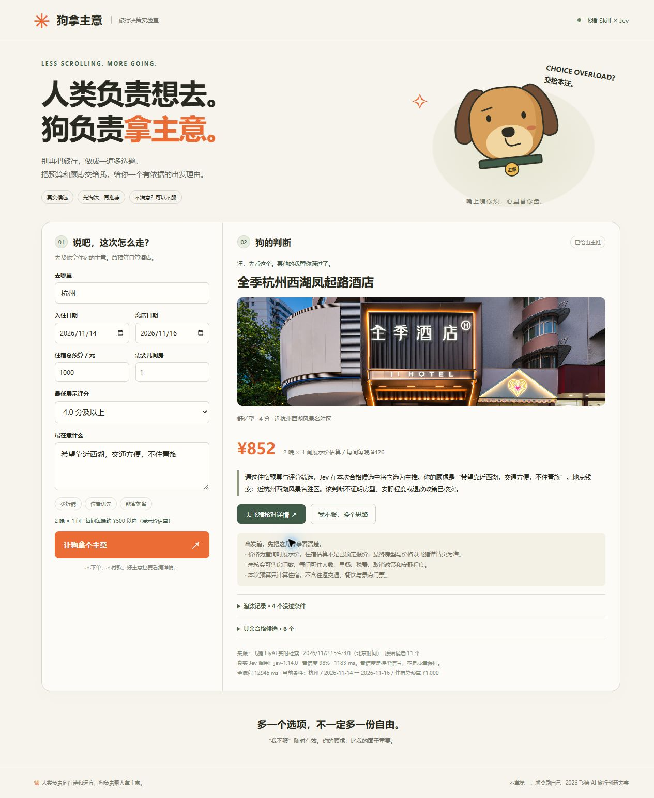

## 参赛项目名称

🐕 狗拿主意 — 基于飞猪 Skill × Jev 决策模型的 AI 旅行决策狗

## 团队 / 作者与奖品领取人

- 团队名称：不拿第一，就奖励自己
- 主要提交人 GitHub ID（仅 1 位，必填）：LucianaiB2004
- 团队口号：懒才是进步的阶梯

## 旅行场景与目标用户

面向想去旅行、却在酒店选择上反复纠结的人。传统 AI 旅行助手常给出很多推荐，我们希望减少比较和决策负担：人类负责向往诗和远方，狗负责帮人拿主意。

## 我做了什么

当前实现酒店选择的可运行闭环：输入城市、入住/离店日期、房间数、住宿总预算和顾虑；调用飞猪官方 Skill/CLI 检索真实候选；由程序先排除不满足日期、预算、评分等条件的候选，再由 TypeSafe 官方 Jev 选择一个有依据的主推。

界面同时展示其他候选的淘汰原因、价格口径、数据时间、Jev 实际模型与置信度，以及未核实风险。用户可以说“我不服”：保留行程和原始顾虑，增加逐轮补充/更正并排除上次主推。证据不足或置信度不足时明确暂缓，不强行推荐。

创新点是从“推荐更多”转向“帮助淘汰和决策”，并用一只嘴上不饶人、实际上认真负责的小狗缓解决策焦虑。

## 百炼使用说明（必填）

- 百炼能力 / 模型：阿里云百炼 Managed Agent，AUTO 智能路由。
- 调用方式：百炼 Managed Agent 控制台会话，使用内置 bash/read 等工具安装并调用官方 FlyAI Skill。
- 使用环节与输入输出：百炼位于开发与验证链路。已在云端创建“狗拿主意”，注入运行时环境变量，安装官方 Skill 与 CLI，执行指定日期的真实酒店搜索并保存结构化结果；完整会话按项目仓库执行安装、测试与真实 FlyAI/Jev 决策验证。独立浏览器界面的运行时由服务端直接调用 FlyAI 与 Jev，不将其描述成每次请求都经过百炼。
- Skill 名称：`alibaba-flyai/flyai-skill` 中的 `flyai`（云端安装版本 1.0.15）。
- 其他工具 / 技术栈：Node.js 原生 HTTP、HTML/CSS/JavaScript、`@fly-ai/flyai-cli` 1.0.16、TypeSafe 官方 System One API（实际响应模型 `jev-1.14.0`）。

## 效果展示

以下是实际浏览器运行截图，使用真实接口，没有用预置结果冒充在线调用。

验证场景：杭州，2026-11-14 至 11-16，1 间、2 晚，住宿总预算 1000 元，最低展示评分 4.0。飞猪返回 11 个候选，规则筛选后 7 个合格。Jev 本轮主推全季杭州西湖凤起路酒店，展示价每间每晚 426 元，住宿估算 852 元。

上述为查询时展示价，不是锁定报价；Jev 置信度不是酒店质量保证。房型、库存、早餐、税费、取消政策等需用户在飞猪详情页确认。本版预算仅计算住宿，不含交通、餐饮和景点门票。

## 项目链接与复现方式

- 源码与完整说明：https://github.com/LucianaiB2004/gou-na-zhu-yi
- 验证记录：https://github.com/LucianaiB2004/gou-na-zhu-yi/blob/main/docs/verification.md
- 克隆后 `npm ci`，将 `.env.example` 复制为 `.env`，填写自己的 `FLYAI_API_KEY` 和 `TYPESAFE_API_KEY`，运行 `npm start`，打开 `http://127.0.0.1:3210`。
- 自动检查：`npm test`（8 项通过）、`npm run check`。
- 百炼会话可调用 `node scripts/decide.mjs examples/trip.json` 复现结构化决策；密钥仅通过服务端环境变量注入。
- 当前提供本地可运行应用与百炼云端验证，不宣称已提供无需配置的公网演示站点。

## 踩坑记录（可选）

1. 飞猪酒店展示价可能很低，不能盲目当成整间房的最终报价。程序排除名称中可识别的青旅/床位，保留明确风险提示，避免将展示价格说成锁定价格。
2. Jev 是类型化决策模型，不是聊天模型；调用官方 `POST /v1/systemone`，校验候选与完整概率分布，增加 `defer` 选项和低置信度暂缓机制。
3. 重选不能丢掉此前的顾虑。独立审查后改为保留原始要求和逐轮补充记录，并增加连续重选回归测试。

> 每个团队最多发放 1 份奖品。本作品仅登记上述 1 位主要提交人。
